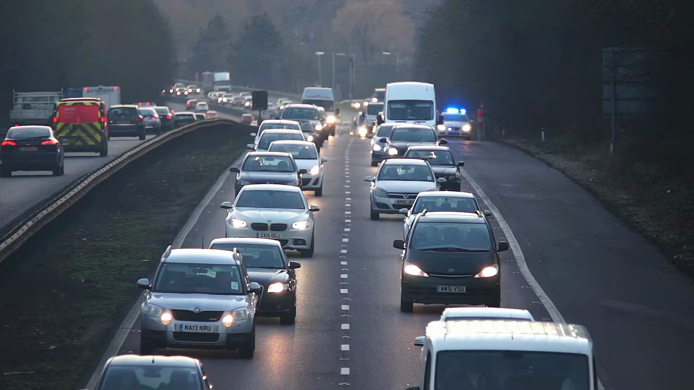

# AI ANPR Studio - Automatic Number Plate Recognition System

An advanced AI-powered Automatic Number Plate Recognition (ANPR) and vehicle tracking web application optimized for **Indian High Security Registration Plates (HSRP)**, **Bharat (BH) Series**, and standard vehicle plates using **YOLOv8** and **EasyOCR**.



## ✨ Key Features

- **High-Accuracy Vehicle & Plate Detection:** Powered by Ultralytics YOLOv8 for vehicle classification (Cars, Motorcycles, Buses, Trucks) and custom license plate bounding box localization.
- **Indian HSRP & BH Series Support:** Formats and verifies plates against all 36 Indian States and Union Territories (e.g. `DL, MH, KA, OD, UP, TN, HR`) and Bharat series (`22 BH 1234 AA`).
- **Context-Aware Character Disambiguation:** Eliminates common OCR letter/number confusions (prevents `T` $\leftrightarrow$ `1`, `Z` $\leftrightarrow$ `2`, `O` $\leftrightarrow$ `0`, `B` $\leftrightarrow$ `8`).
- **All-Vehicle Tracking ("No Vehicle Left Behind"):** Tracks and logs every vehicle visible on screen. Vehicles with visible plates display embossed HSRP badges, and vehicles without direct plate view are tracked with cropped view previews.
- **Multi-Frame Majority Voting Consensus:** For video streams, aggregates OCR candidate readings across multiple frames to select the most consistent, high-resolution plate reading.
- **Modern Dark-Mode Web Studio:** Drag-and-drop interface with Tailwind CSS, real-time scoreboard (latency, vehicle count, plate count), and an **interactive live JSON Viewer popup** (with 1-click Copy & Export).

---

## 🚀 Quick Start

### 1. Clone the Repository
```bash
git clone https://github.com/brslabs786/Numberplate-Recognition-system-.git
cd Numberplate-Recognition-system-
```

### 2. Set Up Virtual Environment & Dependencies
```bash
python3 -m venv .venv
source .venv/bin/activate
pip install -r requirements.txt
```

### 3. Launch the Web Studio
```bash
./run.sh
# Or directly via uvicorn:
uvicorn app:app --host 0.0.0.0 --port 8000 --reload
```
Open your browser and navigate to: **http://localhost:8000**

---

## 📁 Project Structure

```
├── app.py                  # FastAPI Backend API Server
├── engine.py               # Unified ANPR Detection & Video Tracking Engine
├── util.py                 # Indian Plate Formatter, OCR preprocessor & Disambiguation
├── run.sh                  # One-click launch script
├── requirements.txt        # Python dependencies
├── models/
│   └── license_plate_detector.pt  # Custom trained YOLOv8 plate detector
├── yolov8n.pt              # Pretrained COCO vehicle detection model
├── sort/                   # SORT tracker implementation
├── templates/
│   └── index.html          # Modern Tailwind CSS Frontend UI
└── media/                  # Output directory for processed videos
```

## 📜 License
This project is licensed under the MIT / GNU General Public License.
